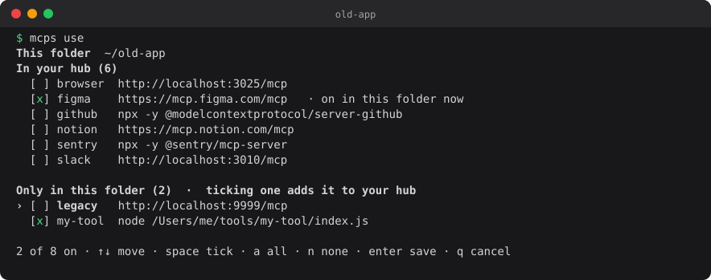
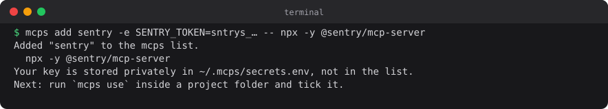

# mcps

**One list of MCP servers for all your AI coding tools.**

Claude Code, Codex, Cursor, Kiro, OpenCode and AGY each keep MCP settings in a different file and
format. Keep your servers in **one list** (the hub), then choose which ones each project folder
uses. `mcps` writes the right config for every tool.

## Install

```bash
brew tap chavisnguyen/mcps https://github.com/chavisnguyen/mcps
brew install mcps
```

No Homebrew? `git clone https://github.com/chavisnguyen/mcps && cd mcps && make build`, then use `bin/mcps`.

## Quick start

**1. Once: fill the hub** with the servers your tools already have.

```bash
mcps import
```

**2. In a project folder: choose its servers.**

```bash
cd ~/work/my-app
mcps use
```



- **In your hub:** every server you have. Tick the ones this folder should use.
- **Only in this folder:** servers found in the folder's current config that are not in the hub
  yet. Ticking one keeps it **and adds it to the hub** for other folders.
- Press `enter`: the folder's MCP config is rewritten for every tool. Old files are backed up first.

Keys: `↑` `↓` move · `space` tick · `a` all · `n` none · `enter` save · `q` cancel.

That's all most people need.

---

## Add a server to the hub

```bash
mcps add notion --url https://mcp.notion.com/mcp                       # remote
mcps add sentry -e SENTRY_TOKEN=your-token -- npx -y @sentry/mcp-server  # local, with a key
mcps add api --url https://example.com/mcp -H "Authorization: Bearer your-token"
```



Keys are **not** written into the hub; they go to `~/.mcps/secrets.env` (private). Then run
`mcps use` in a folder and tick the new server.

## Something not showing up?

| Run | It tells you |
|---|---|
| `mcps doctor` | what is wrong in this folder (missing server, missing key, server not running, ...) and how to fix it |
| `mcps status` | which of your folders no longer match the hub, so you know where to run `mcps sync` |

---

## What gets written in a folder

| File | For |
|---|---|
| `.mcps.toml` | your choice for this folder (safe to commit) |
| `.mcp.json` | Claude Code |
| `.codex/config.toml` | Codex |
| `.cursor/mcp.json` | Cursor |
| `.kiro/settings/mcp.json` | Kiro |
| `opencode.json` | OpenCode |
| `.agents/mcp_config.json` | AGY |

Only tools installed on your machine get a file. To limit it, put `agents = ["claude", "codex"]` in `.mcps.toml`.

> **Keys:** these files (all except `.mcps.toml`) can contain API keys. `mcps` never touches git,
> so add them to `.gitignore` if the repo is shared.

## Good to know

- **`mcps use` replaces the folder's MCP config** with exactly what you chose. Servers you unticked
  are removed from that folder. Every changed file is backed up in `~/.mcps/backups/` first.
- **Global settings are never changed** by `mcps use`. A tool that also has the same server in its
  global settings will see it twice; remove it there if you want one copy.
- **Claude Code's per-project servers** (stored in `~/.claude.json`) are read, but not removed.
- **Where things live:** the hub is `~/.mcps/config/servers.toml` (plain text, you can edit it);
  keys are in `~/.mcps/secrets.env`.
- **Claude Desktop** has no per-folder settings, so it is skipped for folders.
- Some tools ask you to trust or approve project-level MCP config the first time (Codex only
  reads `.codex/config.toml` in trusted projects).
- **Private MCP servers** work: put the launch command in the hub, for example
  `mcps add mytool -- uvx --from git+ssh://git@github.com/you/mytool mytool`. Your own SSH keys authenticate.

## All commands

| Command | What it does |
|---|---|
| `mcps import` | bring in servers your tools already have (global settings + this folder) |
| `mcps import --global` / `--local` | only the tools' global settings / only this folder |
| `mcps import --scan DIR` | also find servers set up in project folders under `DIR` |
| `mcps use` | choose this folder's servers and rewrite its config |
| `mcps add NAME --url URL` / `mcps add NAME -- CMD ARGS` | add a server to the hub |
| `mcps remove NAME` | remove a server from the hub |
| `mcps list` | show the hub |
| `mcps doctor` / `mcps status` | find problems / check folders against the hub |
| `mcps sync` | re-apply this folder's `.mcps.toml` after editing it by hand |
| `mcps validate` | check the hub and project files; changes nothing |
| `mcps init [git-url]` | create the hub, or keep it in a git repo |
| `mcps up NAME` | run a server's `install` command from the hub |
| `mcps global add\|rm\|list` | edit the tools' global settings directly |

Flags: `--dry-run` (show what would change), `--agents claude,codex`, `--dir PATH`.
Options for `add`: `-e KEY=VALUE` (or `-e KEY` to read `$KEY`), `-H "Name: value"`.

## Uninstall

```bash
brew uninstall mcps && brew untap chavisnguyen/mcps
rm -rf ~/.mcps          # your hub, keys and backups
```

Files `mcps` created inside folders are ordinary config files; delete them if you want.
