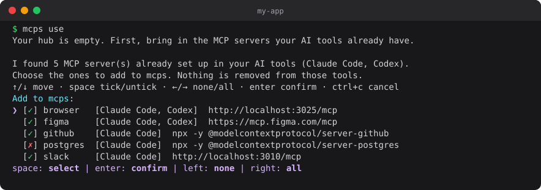
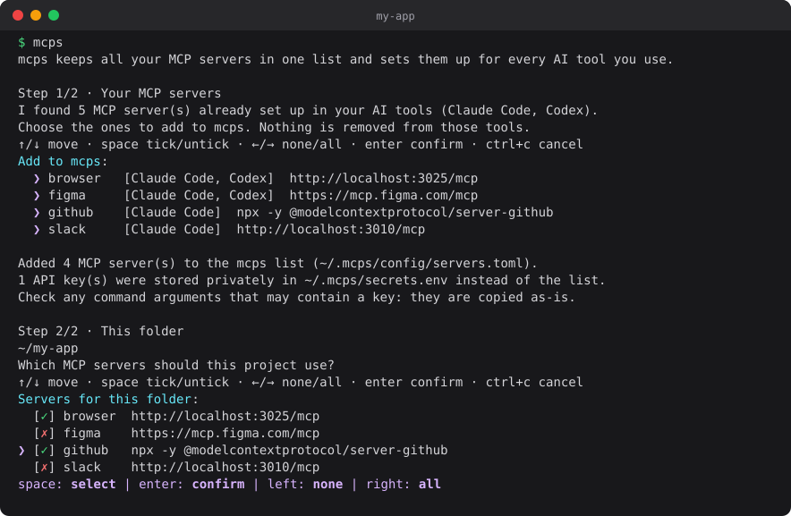
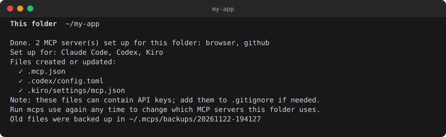
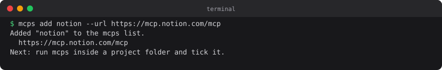
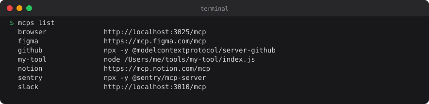
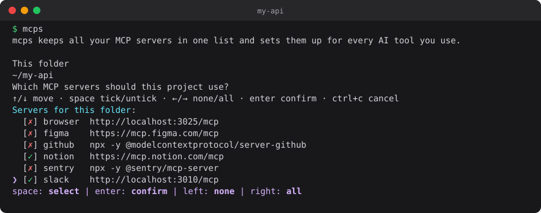
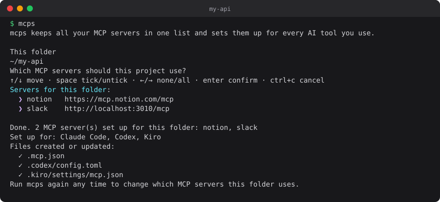

# mcps

**One list of MCP servers for all your AI coding tools.**

Claude Code, Codex, Cursor, Kiro, OpenCode and AGY each keep their MCP settings in a different
file and format. With `mcps` you keep your MCP servers in **one list**, then pick which ones each
project folder should use. `mcps` writes the right config for every tool you have installed.

## Install

```bash
brew tap chavisnguyen/mcps https://github.com/chavisnguyen/mcps
brew install mcps
```

(No Homebrew? `git clone https://github.com/chavisnguyen/mcps && cd mcps && make build`,
then use `bin/mcps`.)

---

## 1. First-time setup

Open a terminal in any project folder and run:

```bash
mcps
```

**Step 1: your MCP servers.** `mcps` finds the MCP servers you already have in your AI tools and
asks which ones to add to its list. Nothing is changed or removed in those tools.



**Step 2: this folder.** Tick the servers this project should use.



That's it. `mcps` creates the config files in the folder for each of your AI tools.



Keys: `↑` `↓` move · `space` tick/untick · `←` none · `→` all · `enter` confirm · `ctrl+c` cancel.

---

## 2. Add a new MCP server later

Add it to the list once, with one command.

A remote server (a URL):

```bash
mcps add notion --url https://mcp.notion.com/mcp
```



A local server (a command), with an API key:

```bash
mcps add sentry -e SENTRY_TOKEN=your-token -- npx -y @sentry/mcp-server
```


Your key is **not** written into the list; it is stored privately in `~/.mcps/secrets.env`.
A remote server that needs a header: `mcps add NAME --url URL -H "Authorization: Bearer your-token"`.

Then turn it on where you need it: run `mcps` in that folder and tick it (see below).

Other things you may want:

| I want to... | Run |
|---|---|
| see everything in the list | `mcps list` |
| remove a server from the list | `mcps remove NAME` |
| pull in servers my tools already have | `mcps import` |



---

## 3. Use specific MCP servers in one folder

Go to the folder and run `mcps`. It remembers what you ticked last time.

```bash
cd ~/work/my-api
mcps
```





Run `mcps` again whenever you want to change the folder's servers: untick one and it is removed
from that folder; tick another and it is added.

What gets created in the folder:

| File | For |
|---|---|
| `.mcps.toml` | your choice for this folder (safe to commit) |
| `.mcp.json` | Claude Code |
| `.codex/config.toml` | Codex |
| `.cursor/mcp.json` | Cursor |
| `.kiro/settings/mcp.json` | Kiro |
| `opencode.json` | OpenCode |
| `.agents/mcp_config.json` | AGY |

Only tools installed on your machine get a file. To limit it, add `agents = ["claude", "codex"]`
to `.mcps.toml`.

> **Keys:** the generated files (everything except `.mcps.toml`) can contain API keys. `mcps` does
> not touch git, so add them to your `.gitignore` if you don't want them committed.

---

## Something not showing up?

Run `mcps doctor` in the folder. It checks your list, your keys, whether each server can start
(or is listening), and whether every tool's file has the servers, then tells you what to run to fix it.

`mcps status` shows, for every folder you have set up, whether it still matches your list.
After you change a server in the list, it tells you which folders need `mcps sync`.

## Good to know

- **Your existing MCP setup is safe.** `mcps` only changes servers it created. Anything you added
  yourself is left alone, and every changed file is backed up in `~/.mcps/backups/` first.
- **Where things live:** the list is `~/.mcps/config/servers.toml` (plain text, you can edit it);
  keys are in `~/.mcps/secrets.env`.
- **Claude Desktop** has no per-folder settings, so it is skipped for folders.
- Some tools ask you to trust or approve project-level MCP config the first time (Codex only
  reads `.codex/config.toml` in trusted projects).
- Servers already in a tool's *global* settings stay there, so a tool can see both.
- Private MCP servers work too: put the launch command in the list (for example
  `mcps add mytool -- uvx --from git+ssh://git@github.com/you/mytool mytool`); your own SSH
  keys do the authentication.

## All commands

| Command | What it does |
|---|---|
| `mcps` | set up MCP servers for the current folder (guided) |
| `mcps add NAME --url URL` / `mcps add NAME -- CMD ARGS` | add a server to the list |
| `mcps remove NAME` | remove a server from the list |
| `mcps list` | show the list |
| `mcps import` | add servers your tools already have (global, plus the current folder) |
| `mcps import --global` / `--local` | only your tools' global settings / only this folder |
| `mcps import --scan ~/Projects` | also find servers set up inside project folders |
| `mcps doctor` | find out why a server is not showing up in a tool |
| `mcps status` | check every folder you set up is still in sync with the list |
| `mcps sync` | re-apply this folder's `.mcps.toml` after editing it by hand |
| `mcps validate` | check the list and project files, changes nothing |
| `mcps init [git-url]` | create the list, or keep it in a git repo |
| `mcps up NAME` | run a server's `install` command from the list |
| `mcps global add\|rm\|list` | edit your tools' global settings directly |

Flags: `--dry-run` (show what would change), `--agents claude,codex`, `--dir PATH`.
Options for `add`: `-e KEY=VALUE` (or `-e KEY` to read `$KEY`), `-H "Name: value"`.

## Uninstall

```bash
brew uninstall mcps && brew untap chavisnguyen/mcps
rm -rf ~/.mcps          # your list, keys and backups
```

Files `mcps` created inside folders are ordinary config files; delete them if you want.
